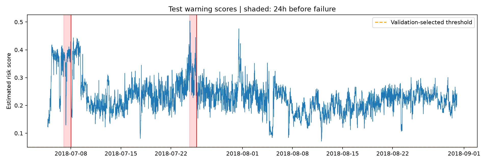
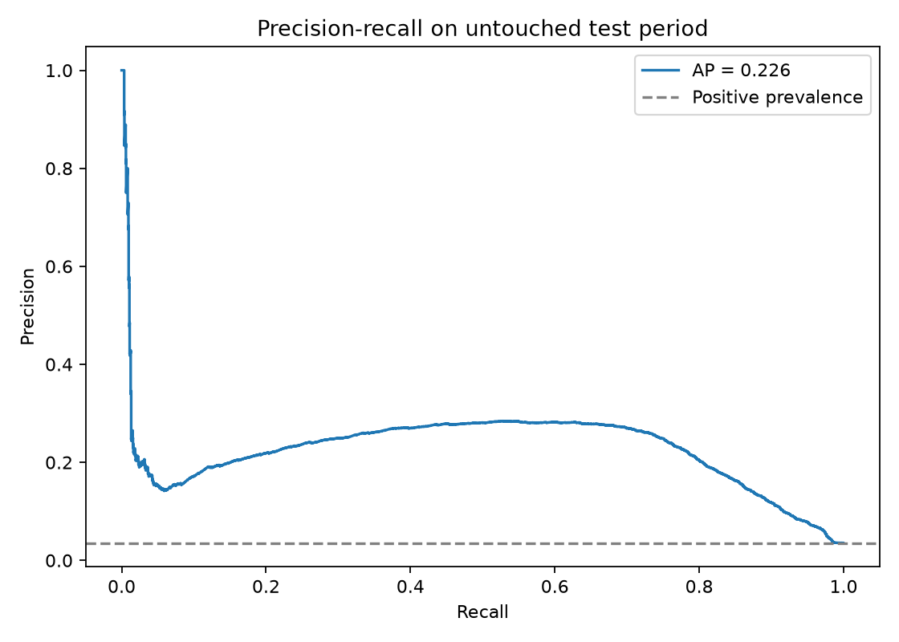
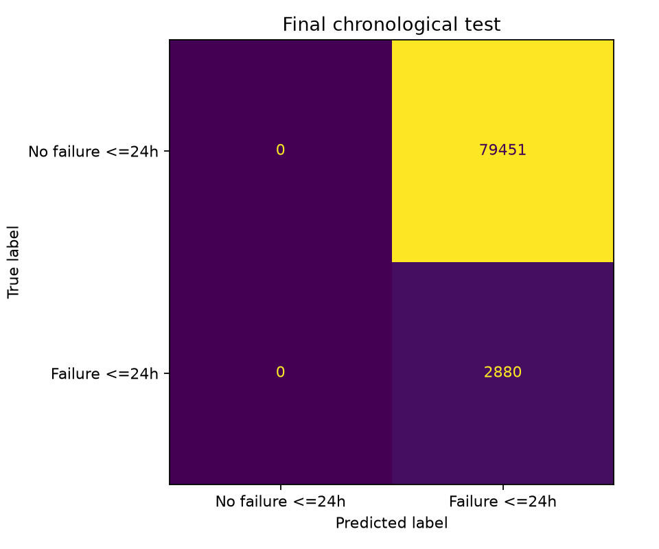
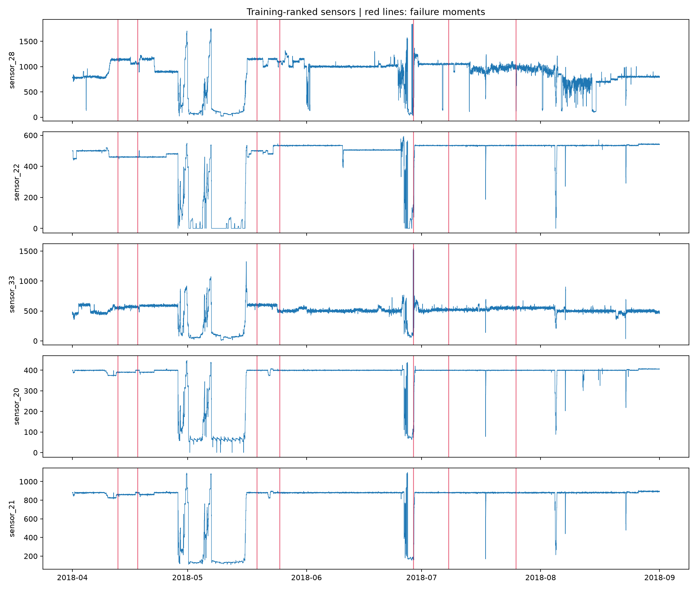
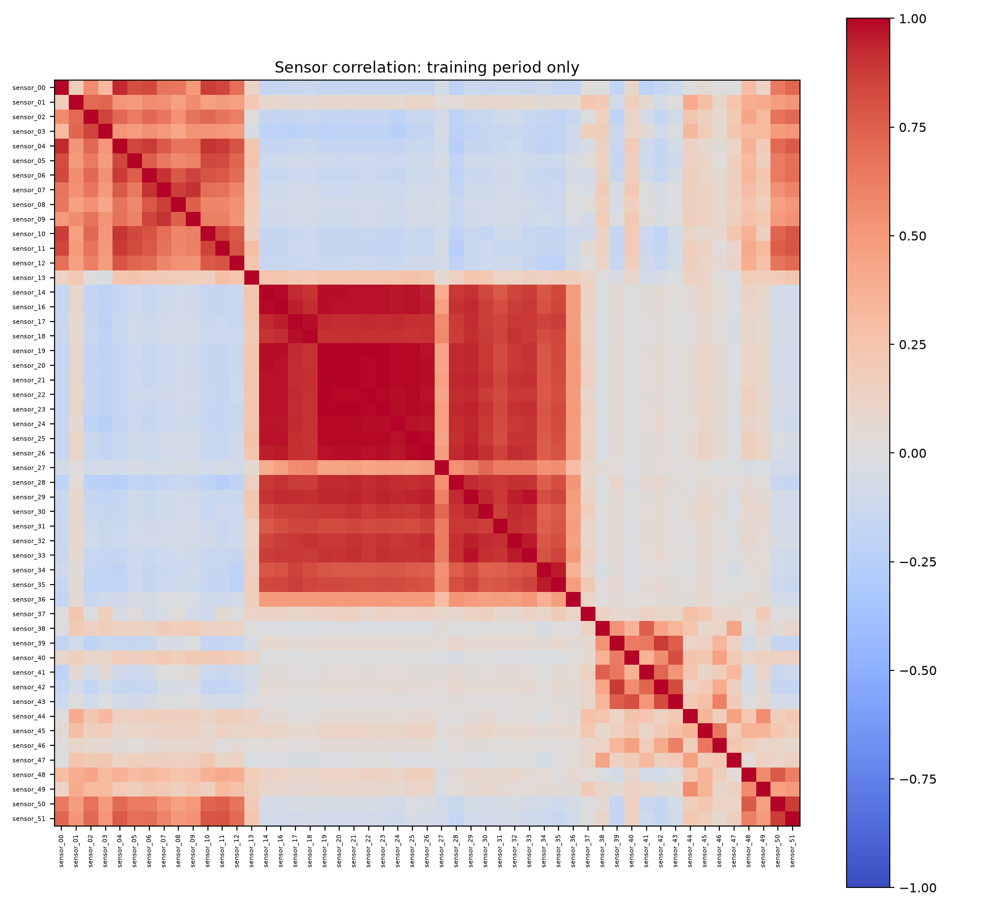

# Water Pump Early Warning — Predictive Maintenance

**Can sensor readings warn of a pump failure within the next 24 hours?** This project builds and critically evaluates a simple Random Forest baseline on minute-level pump data. It demonstrates a causal time-series workflow and the limitations of learning from only seven failure events. The resulting warning policy is **not operationally useful** on the held-out period: it alerts continuously.

## Data

Source: [Kaggle: Pump Sensor Data](https://www.kaggle.com/datasets/nphantawee/pump-sensor-data).

The supplied file contains **220,320 rows × 55 columns**, from April 1 through August 31, 2018, at one-minute intervals: 52 anonymized sensors, timestamp, status, and one redundant row index.

| Status | Minutes |
|---|---:|
| NORMAL | 205,836 |
| RECOVERING | 14,477 |
| BROKEN | 7 |

BROKEN represents seven recorded failure moments, only 0.00318% of all rows. The new 24-hour target has more positive minutes, but they still correspond to very few independent events. Raw timestamp is read as object and explicitly converted to datetime. Full column types are in `results/original_dtypes.csv`.

## Run

Use Python 3.11+ and install dependencies in a virtual environment:

```bash
pip install -r requirements.txt
python main.py --data data/sensor.csv
```

Download the original CSV into `data/`. It is excluded from this repository because it exceeds 100 MiB and the source lists an unknown license. The script regenerates every results file and figure. No Kaggle credentials are needed once the CSV is local.

## Workflow

1. Audit dimensions, types, statuses, missingness, timestamp uniqueness and regularity.
2. Remove sensors exceeding 50% missingness **in training only**. This removes `sensor_15`, whose entire supplied series is missing. Retain `sensor_50` despite 34.96% overall missingness; inspect missingness risk before deploying. Ignore the redundant `Unnamed: 0` column through explicit sensor selection.
3. Forward-fill for at most 60 minutes, then fill remaining gaps with training-only sensor medians. This uses past information, unlike backward filling or interpolation from future readings. The 60-minute cap is an explicit modeling assumption; long gaps revert to a static estimate and may lose useful information. Full-series missing percentages are descriptive and do not determine model preprocessing.
4. Rank precursor shifts using **training failures only**: compare each event's preceding 24 NORMAL hours with its earlier 7-day-to-48-hour NORMAL baseline; take the median absolute standardized mean shift across events. Leading candidates: `sensor_28`, `sensor_22`, `sensor_33`, `sensor_20`, `sensor_21`. All retained sensors go into the model; this ranking is exploratory, not proof of causality. Estimate sensor correlations on training data only.
5. Create a label equal to 1 when a BROKEN event falls in **(t, t + 24 hours]**. Only NORMAL minutes are eligible for early-warning classification. Exclude BROKEN and RECOVERING minutes and the final 24 hours, whose future is unobserved. Status defines labels/eligibility and is never a predictor.
6. Build current sensor values, trailing 60-minute means, and 60-minute differences. No future measurements enter features. Historical context is carried across split boundaries because it would be available during live scoring. Initial difference values are set to zero.
7. Train a Random Forest with 120 trees, maximum depth 12, minimum leaf size 20, balanced subsample weights and seed 42. Tune the alert threshold on validation F1 over 0.05–0.95 in 0.05 increments. This is a baseline choice, not an operational cost optimization.
8. Report minute-level metrics, event detection, first-warning lead times, false-warning minutes and alert episodes. Episodes are consecutive eligible alert minutes, broken at timestamp gaps; an episode is considered associated with failure if any of its minutes has a positive target. This lenient episode rule must be read together with false-warning duration.

## Chronological evaluation

| Partition | Period | Eligible minutes | Positive minutes | Failures |
|---|---|---:|---:|---:|
| Training | April–May | 80,425 | 5,760 | 4 |
| Validation | June | 40,200 | 1,440 | 1 |
| Test | July–August | 82,331 | 2,880 | 2 |

Purge the final 24 hours before June 1 and July 1 so label horizons do not cross partitions. Do not randomly shuffle: neighboring minutes are strongly dependent and minutes before the same failure could otherwise enter both training and test, overstating generalization. The last 24 hours of August are censored. Month boundaries were fixed before fitting; test data did not select features, imputation parameters or threshold.

## Results — an informative baseline failure

Validation F1 selects **threshold 0.05**. On the final test set:

| Metric | Result |
|---|---:|
| Precision | 3.50% |
| Recall | 100% |
| F1 | 0.0676 |
| Accuracy | 3.50% |
| Average precision | 0.2439 |
| ROC AUC | 0.9054 |
| Failure events covered | 2 / 2 |
| False-warning minutes | 79,451 |
| Always-negative accuracy | 96.50% |

The model alerts at **every eligible test minute** at the selected threshold. Both failures receive an apparent 24-hour lead time, but this is a consequence of continuous alerts and cannot establish useful early warning. The one wholly false alert episode hides a severe burden: 79,451 false-warning minutes, approximately 55.17 days. Other long episodes overlap actual pre-failure windows and are therefore not counted as wholly false episodes. Precision and duration make that weakness visible.

Ranking metrics indicate some separation in scores, but ROC AUC does not demonstrate a useful operating point. `default_threshold_metrics.json` also reports the predeclared 0.5 threshold for transparency; it is not selected using test performance. The near-continuous warning outcome suggests poor threshold transfer and possible temporal distribution shifts; these are hypotheses requiring further study.





## Sensor analysis




Training-ranked precursor candidates represent changes in measured operating conditions before breakdown. From a maintenance perspective, these are channels worth investigating alongside operating logs, calibration records, pump load and maintenance history. Unknown names, units and sensor locations prevent claims about vibration, temperature, pressure, bearings or a specific failure mechanism. Correlation can reflect common load or operating state rather than a causal fault. Correlation and ranking CSVs are included for inspection.

## Why accuracy alone fails

On test data, always predicting no upcoming failure achieves 96.50% accuracy and detects no failures. Missing a real failure can disrupt water supply, so event recall matters, but excessive false alarms can cause alert fatigue and unnecessary inspections. An acceptable policy needs event coverage, useful lead time and a tolerable false-alarm burden jointly. The appropriate tradeoff requires operator costs and response capacity; F1 is only an educational proxy.

## Limitations and next steps

- Only 4 training, 1 validation and 2 test failures. Thousands of correlated minutes do not substitute for independent failure events. No reliability claim or robust uncertainty estimate is supported.
- The baseline fails as an actionable alarm policy; this is an exploratory portfolio project, not a deployed monitoring system.
- Anonymized sensors, unknown physical units, limited operating context and substantial missingness constrain diagnosis.
- Filling long gaps with a median may distort signals. A future experiment should evaluate missingness indicators and sensor availability using training/validation only.
- There is no calibrated probability guarantee; the output is a model score. One validation failure is insufficient for stable threshold tuning.
- Collect more events and maintenance logs. Assess rolling chronological folds with horizon purging, probability calibration, persistence/cooldown policies and costs on validation before one new untouched test. Do not retune on this test to improve the reported headline.
- Results depend on the supplied CSV and the pinned environment. Raw data is not redistributed; users obtain it from its source.

## Repository contents

`main.py` implements all six stages; `requirements.txt` pins dependencies; `results/` includes audit tables, sensor ranking, correlation, threshold search, predictions, event/episode tables, metric JSONs and figures. `NOTES.md` summarizes the engineering decisions and reasoning behind each stage. `LINKEDIN_POST.md` provides an honest English portfolio post.
